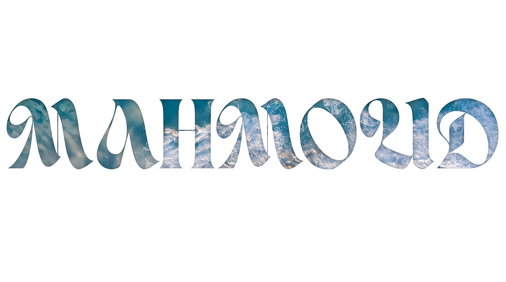
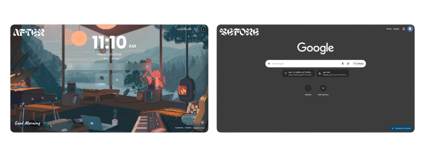

  

  
  
  
  
  
  
  
  

### About Me

> I am a web designer and developer who transforms ideas into visually stunning, high-performing digital experiences. I craft modern interfaces tailored to each client's brand identity, writing clean, custom code from scratch without relying on heavy bloated frameworks to guarantee complete control over performance, speed, and seamless scalability. In addition, I build intuitive browser tools and digital solutions designed to elevate everyday productivity and visual aesthetics.

### Project Concept

> **vutamo Appearance** is a premium, high-performance Chromium New Tab extension designed to transform your daily browsing into an elegant, cinematic dashboard. Engineered with modern **Manifest V3** standards and lightweight vanilla JavaScript, it delivers ambient live-motion backgrounds, an intelligent search experience with real-time suggestions, drag-and-drop Google Apps launcher, customizable quick shortcuts, and live weather telemetry without sacrificing startup speed.

### Built With

>     

 

  

### Key Features

> **Cinematic Ambient Video:** High-definition live motion background with adjustable frosted glass blur intensity and smooth performance.
>
> **Interactive Branding:** Bottom-right branding with direct click-through to developer portfolio at [mahmoudsoft.com](https://mahmoudsoft.com).
>
> **Intelligent Search Experience:** Google search integration featuring real-time autocomplete suggestions, direct URL recognition, and one-click Google Lens support.
>
> **Interactive Google Apps Suite:** Integrated Google Apps grid drawer supporting full drag-and-drop reordering, favorites management, and instant access.
>
> **Custom Bookmarks & Shortcuts:** Quick-access shortcuts with automatic favicon detection, add, edit, and delete functionality, all persisted locally.
>
> **Live Weather & Geolocation:** Automatic IP-based location and real-time weather conditions via Open-Meteo API with intelligent 30-minute caching.
>
> **Smart Digital Clock & Typewriter Greeting:** Customizable 12h/24h clock with optional seconds counter and a dynamic typewriter greeting matching the time of day.
>
> **Appearance Settings Drawer:** Dedicated sidebar allowing instant customization of background blur amount, clock format, and shortcuts visibility.

### How to Install (Chrome Developer Mode)

1. Clone or download this repository to your local machine.
2. Open Google Chrome (or any Chromium-based browser) and navigate to `chrome://extensions/`.
3. Enable **Developer mode** using the toggle switch in the top right corner.
4. Click on **Load unpacked** in the top left corner.
5. Select the project folder containing `manifest.json`.
6. Open a new tab to enjoy your customized **vutamo Appearance**!

### Version History

| Version | Release Date | Description | Download |
| :---: | :---: | :--- | :---: |
| `v1.0.0` | 2026-10-23 | Initial release with live video backgrounds, Google Apps drawer, real-time search suggestions & weather widget | [v1.0.0.zip](https://github.com/mahmoud-soft/Vutamo-Appearance-Extraction/archive/refs/tags/v1.0.0.zip) |

### Website

> [mahmoudsoft.com](https://mahmoudsoft.com)

 

  <strong>Thank You</strong> ❤️

